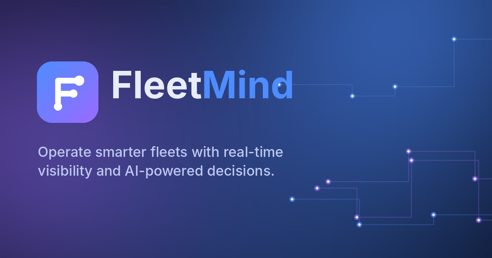

# FleetMind

**A fleet operations workspace for vehicles, drivers, deliveries, routes, maintenance, and analytics.**

[](https://fleetmind-frontend.onrender.com)

> **Demo environment:** The live site is a public demonstration. Its organization and records are fictional, and all demo users share a published password. Do not enter real or sensitive information.

## Product preview



Open the [live FleetMind demo](https://fleetmind-frontend.onrender.com) to explore the application. Sign in with the demo account below to see the fleet workspace.

## Demo account

The seeded organization, **Selam Freight (Demo)**, includes 14 vehicles, 12 drivers, about 190 deliveries, fuel and maintenance history, routes, and geofences. The records use fictional identities and approximate Addis Ababa locations. Some records intentionally have expired documents, late deliveries, or unusual fuel entries so alerts and anomaly screens have examples to show.

| Access | Email | Password |
|---|---|---|
| Owner | `owner@example.com` | `FleetMind-Demo-2026` |
| Admin | `admin@example.com` | `FleetMind-Demo-2026` |
| Dispatcher | `dispatcher@example.com` | `FleetMind-Demo-2026` |
| Viewer | `viewer@example.com` | `FleetMind-Demo-2026` |

Use **Owner** to explore all modules. The other roles demonstrate permission differences. If the live account is missing, the demo database has not been seeded; deployers can prepare it using the command under [Seed the demo environment](#seed-the-demo-environment).

## Features

- Manage vehicles, drivers, deliveries, fuel, maintenance, inspections, and team access.
- Track simulated demo vehicle locations, manage geofences, and plan routes.
- Review notifications, operational analytics, CSV exports, and PDF reports.
- Explore rule-based fuel, delay, and maintenance insights, plus optional Groq-backed assistance.
- Keep organization data tenant-scoped with role-based access controls.

The AI provider, email, SMS, storage, and road-routing integrations need their own credentials and configuration. See [docs/PROJECT_AUDIT.md](docs/PROJECT_AUDIT.md) for implemented features, verification status, and known limits.

## Run locally

### Backend (PowerShell, Python 3.12)

The simplest local setup uses SQLite and does not require Docker or Supabase. In a terminal:

```powershell
cd backend
py -3.12 -m pip install -r requirements.txt
$env:DATABASE_URL = 'sqlite:///C:/Users/<your-user>/AppData/Local/Temp/fleetmind-local-dev.db'
$env:ENVIRONMENT = 'development'
$env:SECRET_KEY = 'dev-only-local-fleetmind-secret-key-change-me'
$env:CORS_ORIGINS = 'http://localhost:5173'
py -3.12 -m alembic upgrade head
py -3.12 -m app.seed
py -3.12 -m uvicorn app.main:app --reload --host 127.0.0.1 --port 8000
```

Replace `<your-user>` with your Windows account name. Keep this terminal open.

### Frontend (Node.js 20+)

In a second terminal:

```powershell
cd frontend
npm ci
npm run dev
```

Open [http://localhost:5173](http://localhost:5173), choose **Owner** on the sign-in page, and sign in with the demo credentials above. The frontend defaults to the local API at `http://localhost:8000`.

### Docker Compose

Compose expects a Supabase PostgreSQL database; it does not start a local PostgreSQL container. Copy `backend/.env.example` to `backend/.env`, set `DATABASE_URL` to the PostgreSQL connection URI from Supabase, set a strong `SECRET_KEY`, then run:

```powershell
docker compose up --build
```

Demo seeding on startup is controlled by `SEED_DEMO_ON_START` (enabled in the backend example configuration for local development). To rebuild only the demo organization, use `./scripts/seed-demo.sh --reset` from a shell with Docker Compose available. See [docs/SEED.md](docs/SEED.md) for seed behavior and safety details.

## Seed the demo environment

The generated demo dataset is deterministic and safe to run repeatedly. In a production deployment, the seeder requires an explicit override because its credentials are public. For a dedicated public demo database only, run this once from the backend service/container after migrations:

```sh
python -m app.seed --allow-production
```

This creates the demo organization and all four accounts. It refuses to take over a demo email already used by another organization. Do not seed a database that contains customer data. The dataset and reset safeguards are documented in [docs/SEED.md](docs/SEED.md).

To show the role shortcuts on the sign-in page, build the frontend with `VITE_DEMO_LOGIN=true`. Keep this enabled only on a dedicated public demo deployment.

## Project checks

```sh
cd backend && pytest -q
cd frontend && npm ci && npm run build
```

GitHub Actions runs the backend suite, frontend build, and production image build checks on pushes to `main` and pull requests.

## Documentation

- [Project audit and integration status](docs/PROJECT_AUDIT.md)
- [Demo data and accounts](docs/SEED.md)
- [Deployment](docs/DEPLOYMENT.md)
- [Analytics](docs/ANALYTICS.md)
- [AI center](docs/AI.md)
- [Core modules](docs/MODULES.md)
